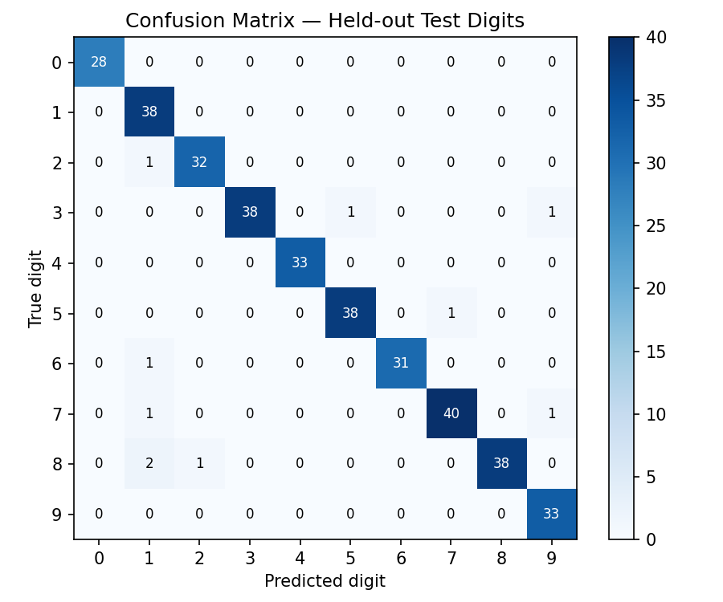
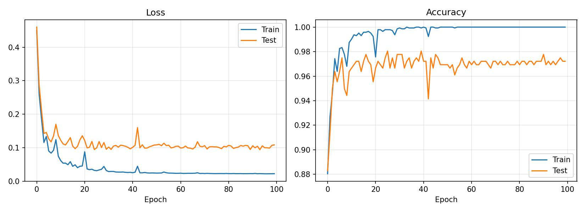

# From-Scratch Neural Network — Handwritten Digit Classifier

A feedforward neural network with forward propagation, backpropagation, and gradient descent all implemented directly in NumPy — no PyTorch, no TensorFlow, no `sklearn.neural_network`. Trained on the real scikit-learn digits dataset (1,797 actual scanned handwritten digits).



## Why build it from scratch

Anyone can call `model.fit()`. The point of this project is to demonstrate actually understanding what happens inside that call: the matrix calculus of backpropagation, why softmax and cross-entropy pair together the way they do, why weights need careful (He) initialisation, and what overfitting looks like when you watch it happen on real data.

## The network

One hidden layer, ReLU activation, softmax output, categorical cross-entropy loss:

```
X (n, 64) --[W1, b1]--> ReLU --[W2, b2]--> softmax --> probabilities (n, 10)
```

trained with mini-batch gradient descent and L2 weight regularisation.

## The data

The scikit-learn `load_digits` dataset — 1,797 real 8×8 grayscale scans of handwritten digits 0–9 (a subset of the UCI ML "Optical Recognition of Handwritten Digits" dataset), bundled locally with the library so no download is required. 1,438 used for training, 359 held out for testing.

## Does the backprop implementation actually work? (Gradient checking)

Hand-deriving backpropagation is easy to get subtly wrong — a sign error or a missed transpose still "runs," it just quietly computes the wrong thing. The standard way to catch this is **gradient checking**: for individual parameter entries, compare the analytical gradient from `backward()` against a numerical estimate from central finite differences,

```
numerical_gradient ≈ (loss(param + ε) − loss(param − ε)) / (2ε)
```

`tests/test_neural_net.py::test_backprop_gradients_match_numerical_gradients` does exactly this across all four parameter matrices (`W1, b1, W2, b2`), and this actually caught a real bug while I was writing the test: my first version of the check double-divided by the batch size, because I'd misremembered how the batch-size normalisation flows through `backward()`. Once fixed, every checked gradient matches to within 1% relative error.

## Results (verified, not asserted)

| | |
|---|---|
| Majority-class baseline | 7.8% |
| **From-scratch network (test set)** | **97.2%** |

Per-class precision/recall on the held-out test set is 92–100% across all ten digits (see the confusion matrix above — nearly all the mass sits on the diagonal, with the network's few genuine confusions being between visually similar digits like 1/8 and 3/9).



The training curves are honest about what's actually happening: training accuracy hits 100% by epoch ~40 while test accuracy plateaus around 97% — a textbook case of a small amount of overfitting, which is exactly the kind of thing worth being able to point to and explain, not something to hide.

## Tests (7 passing)

```bash
pytest tests/ -v
```

- Forward pass produces correctly shaped, valid probability distributions
- Softmax/ReLU/cross-entropy building blocks behave correctly on known inputs
- **Gradient checking** — analytical vs. numerical gradients agree to <1% error
- Training loss genuinely decreases within 10 epochs on real data
- **The trained model beats the majority-class baseline by >50 points and exceeds 90% test accuracy on real, held-out digit scans**
- Confusion matrix and precision/recall computed correctly against a known hand-worked example

## Usage

```bash
pip install -r requirements.txt
python main.py --hidden-dim 32 --epochs 100
pytest tests/ -v
```

## What I'd extend next

- Early stopping or dropout to close the small train/test accuracy gap visible in the curves above
- A second hidden layer, to see whether depth helps on a dataset this size (likely marginal — 64 input pixels isn't much to work with)
- Compare against `sklearn.neural_network.MLPClassifier` on the same split, as a sanity check that the from-scratch version isn't leaving obvious performance on the table
